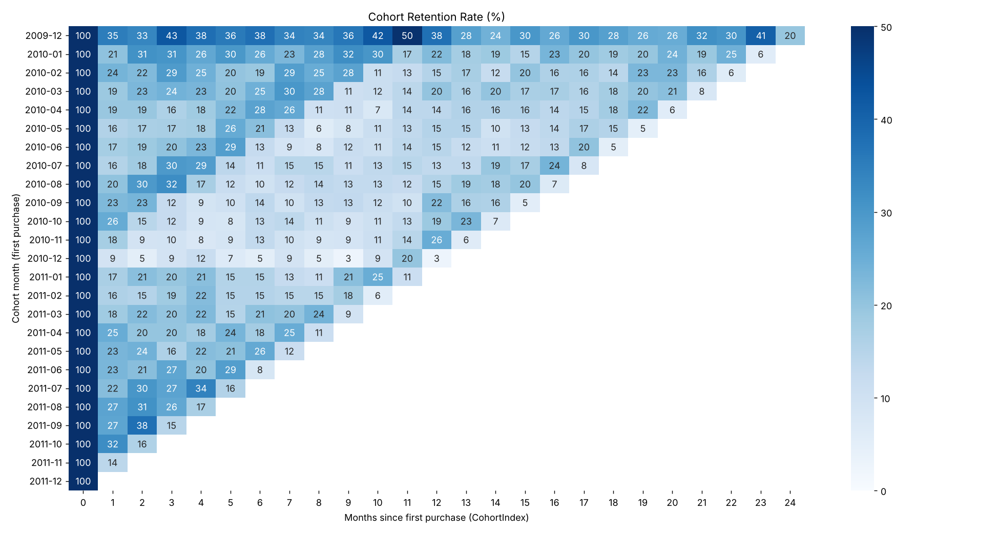
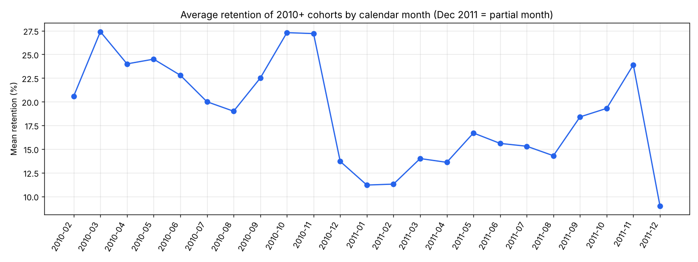
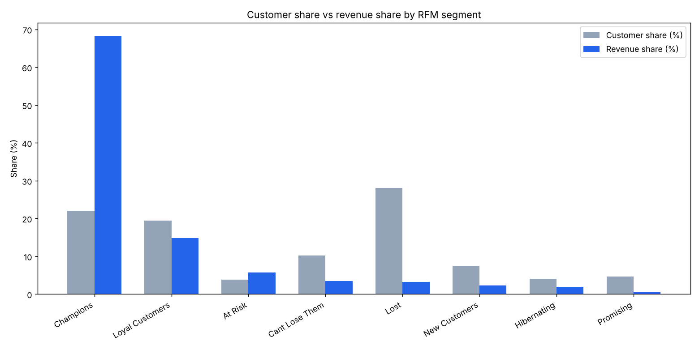
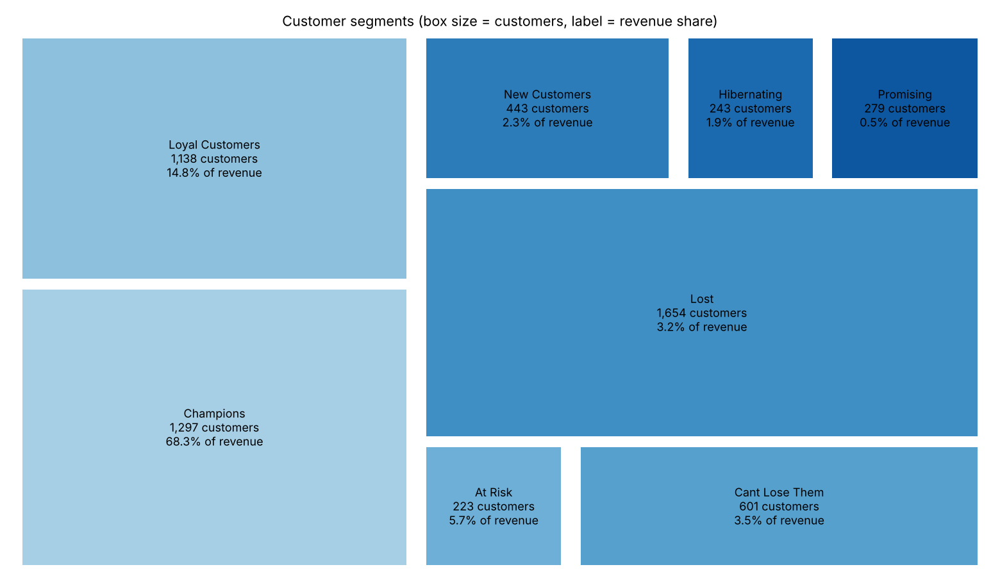
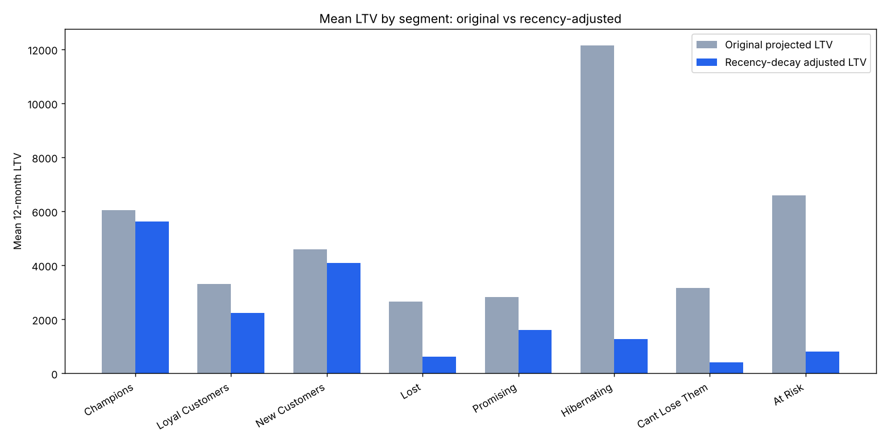
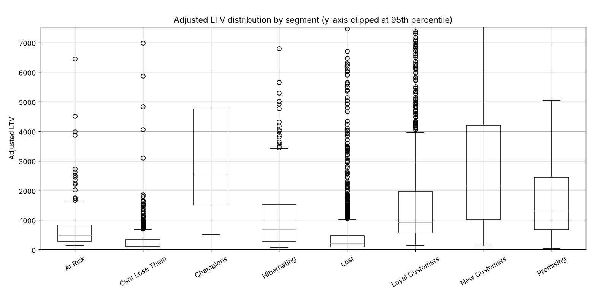

# Online Retail II 고객 분석: 코호트 · RFM · LTV

영국 도매 온라인 리테일러의 거래 데이터(2009-12 ~ 2011-12)로 **신규 고객의 재구매(코호트)**, **매출을 만드는 고객(RFM 세그멘테이션)**, **고객별 향후 가치(LTV)**를 분석한 프로젝트입니다. 분석은 Python(pandas)으로 하고, 핵심 로직은 MySQL로 다시 구현해 결과를 교차 검증했습니다.

## 핵심 요약

- 정제 후 고객 5,878명 중 **Champions 22%(1,297명)가 매출의 68%**를 차지합니다. Loyal Customers까지 합치면 고객 41.5%가 매출 83.1%를 만듭니다.
- **2009-12 코호트의 높은 리텐션(30~50%)은 실제 충성도가 아니라 데이터 시작 시점 편향(left-censoring)**입니다. 2010-01 ~ 2011-11 코호트의 첫 달 리텐션 평균은 20.6%입니다.
- 코호트를 달력 월 기준으로 다시 보면 **10~11월에 리텐션이 함께 오르고 12월에 떨어지는 패턴**이 보입니다.
- 구매 속도만 보는 단순 LTV는 이미 구매가 끊긴 **Hibernating을 평균 LTV 1위(12,142)로 오판**합니다. Recency 감쇠를 적용하면 1,273으로 줄어듭니다(-90%).
- pandas(`qcut`)와 SQL(`NTILE`)은 같은 구조(소수 고객에 매출 집중)를 보여주지만 동점 처리 방식 차이로 세그먼트 경계에서 소폭 차이가 납니다.

## 분석 질문

1. 신규 고객은 첫 구매 이후 얼마나 다시 구매하는가?
2. 누가 매출을 만들고, 이탈 위험이 있는 고가치 고객은 누구인가?
3. 고객별 향후 12개월 가치는 얼마이며, 최근 구매 여부를 반영하면 순위가 어떻게 바뀌는가?

## 기술 스택

Python (pandas, numpy, matplotlib, seaborn, squarify) · MySQL 8.0 (윈도우 함수, CTE, VIEW)

## 프로젝트 구조

```
.
├── README.md
├── requirements.txt
├── data/
│   └── README.md                  # 데이터 다운로드 방법 (원본/가공 데이터는 커밋하지 않음)
├── src/
│   ├── 01_clean_data.py           # 두 시트 병합, 데이터 정제
│   ├── 02_cohort_analysis.py      # 코호트 리텐션 + 히트맵 + 달력 월 분석
│   ├── 03_rfm_segmentation.py     # RFM 점수화, 8개 세그먼트, 시각화
│   ├── 04_ltv.py                  # 12개월 LTV, 이진/감쇠 보정, 시각화
│   └── 05_load_to_mysql.py        # 정제 데이터를 MySQL에 적재
├── sql/
│   ├── 01_cohort_retention.sql
│   ├── 02_customer_rfm_view.sql
│   ├── 03_segment_summary.sql
│   └── 04_ltv.sql
└── images/                        # 분석 결과 차트
```

---

## 1. 데이터와 정제

**데이터**: [UCI Online Retail II](https://archive.ics.uci.edu/dataset/502/online+retail+ii) 원본 xlsx (시트 2개, 1,067,371행). 컬럼: Invoice, StockCode, Description, Quantity, InvoiceDate, Price, Customer ID, Country

| 단계 | 제거 | 남은 행 |
|---|---:|---:|
| 원본 (두 시트 병합) | - | 1,067,371 |
| 완전 중복행 제거 | 34,335 | 1,033,036 |
| 취소 주문(Invoice가 `C`로 시작) 분리 | 19,104 | 1,013,932 |
| Customer ID 결측 제거 | 234,437 | 779,495 |
| Price·Quantity가 0 이하인 행 제거 | 70 | **779,425** |

**의사결정**

- **취소 주문**은 버리지 않고 `online_retail_cancelled.csv`로 따로 보관했습니다(반품률 분석용). 대신 메인 분석의 Monetary는 반품을 차감하지 않은 **총매출 기준**입니다.
- **Customer ID 결측(22.8%)**은 채울 수 있는 값이 아니고 고객 단위 분석이 불가능해 제외했습니다(비회원 주문으로 추정). 이후 모든 매출 비중은 식별된 고객 5,878명 기준입니다.
- **Price·Quantity ≤ 0**은 샘플·재고 조정 등 정상 거래가 아니라고 판단했습니다.

코드: [`src/01_clean_data.py`](src/01_clean_data.py)

---

## 2. 코호트 리텐션 분석

고객의 첫 구매월을 코호트로 묶고, 첫 구매 후 몇 개월째에 다시 구매했는지(CohortIndex)를 추적했습니다.



**해석**

1. **2009-12 코호트(955명)는 매달 30~50%로 비정상적으로 높습니다.** 데이터가 이 달에 시작되기 때문에, 그 이전부터 거래하던 기존 단골이 모두 신규처럼 잡힌 것입니다(left-censoring). 신규 고객 리텐션을 판단할 때는 제외하거나 주석 처리해야 합니다.
2. 2010-01 ~ 2011-11 코호트의 **첫 달 리텐션은 평균 20.6%**(최저 9.2% 2010-12 코호트, 최고 32.1% 2011-10 코호트)이고 이후에는 완만하게 유지됩니다. 가장 큰 허들은 **두 번째 구매**입니다.
3. 2010-12 코호트는 규모(76명)와 첫 달 리텐션(약 9%)이 모두 가장 낮습니다.
4. 히트맵이 상삼각형인 것은 정상입니다. 늦은 코호트일수록 관측 가능한 개월 수가 적기 때문입니다.

**달력 월 기준으로 다시 보기**: 2010년 이후 코호트의 재구매율을 *재구매가 일어난 달력 월*별로 평균하면 10~11월에 올라가고 12월에 떨어집니다.



| 달력 월 | 2010-09 | 2010-10 | 2010-11 | 2010-12 |
|---|---:|---:|---:|---:|
| 평균 리텐션(%) | 22.5 | 27.3 | 27.2 | 13.7 |

연말 성수기 도매 수요 같은 **달력 효과일 가능성**이 있지만, 달마다 포함되는 코호트 구성이 달라 결론으로 단정할 수는 없습니다. 2011-12는 12월 9일까지의 부분 데이터입니다.

코드: [`src/02_cohort_analysis.py`](src/02_cohort_analysis.py)

---

## 3. RFM 세그멘테이션

- **Recency**: 기준일(마지막 거래일 + 1일) − 고객의 마지막 구매일
- **Frequency**: 고유 Invoice 수
- **Monetary**: Quantity × Price 합계
- 각 지표를 5분위로 점수화(`pd.qcut`)하고, 규칙 기반으로 8개 세그먼트로 분류했습니다. Frequency는 1회 구매 고객이 많아 `rank(method='first')`를 먼저 적용했습니다.

| 세그먼트 | 고객 수 | 고객 비중 | 평균 Recency(일) | 평균 Frequency | 평균 Monetary | 매출 비중 |
|---|---:|---:|---:|---:|---:|---:|
| Champions | 1,297 | 22.1% | 20.0 | 17.1 | 9,144 | **68.3%** |
| Loyal Customers | 1,138 | 19.4% | 73.4 | 5.9 | 2,255 | 14.8% |
| At Risk | 223 | 3.8% | 342.3 | 9.0 | 4,404 | 5.7% |
| Cant Lose Them | 601 | 10.2% | 379.0 | 3.4 | 1,010 | 3.5% |
| Lost | 1,654 | 28.1% | 378.4 | 1.5 | 336 | 3.2% |
| New Customers | 443 | 7.5% | 28.1 | 1.5 | 886 | 2.3% |
| Hibernating | 243 | 4.1% | 416.9 | 1.6 | 1,360 | 1.9% |
| Promising | 279 | 4.7% | 108.2 | 1.2 | 287 | 0.5% |





**해석**

- Champions는 고객의 22%인데 매출의 68%를 차지합니다. 다만 Champions 정의에 M_Score 4 이상이 포함되어 있어 이 집중도의 일부는 정의에서 오는 구조적 결과입니다. 결론은 **소수 핵심 고객에 대한 매출 의존도가 매우 높다**는 것으로 읽는 것이 정확합니다.
- Monetary는 평균 2,956에 표준편차 14,441, 최댓값 580,987이고 Frequency 최댓값은 398입니다. 개인 소비자보다 **도매·재판매 고객이 섞인 B2B 성격**으로 보이며, 극단값은 제거하지 않고 분위수 점수화로 영향을 완화했습니다.
- **이탈 위험 고가치 고객**(At Risk 223명 + Cant Lose Them 601명)은 매출의 9.2%를 차지합니다. 특히 At Risk는 평균 9회 구매, 평균 4,404 지출의 과거 우량 고객이라 win-back 우선순위가 가장 높습니다.
- **신규 유입**(New Customers + Promising)의 매출 기여는 2.8%입니다. 코호트에서 본 두 번째 구매 허들과 같은 결론입니다.

코드: [`src/03_rfm_segmentation.py`](src/03_rfm_segmentation.py)

---

## 4. LTV (고객 생애 가치)

```
LTV_12M = 평균 구매액(AOV) × 월 구매 빈도 × 12  ( = Monetary / 관측 개월 수 × 12 )
```

- **원본**: 위 공식 그대로의 선형 외삽
- **이진 보정**: 최근 180일 이내 구매했으면 활성(×1), 아니면 0
- **감쇠 보정**: `LTV × exp(-Recency / 180)`로 Recency가 길수록 연속적으로 감소

| 세그먼트 | 원본 평균 | 이진 보정 평균 | 감쇠 보정 평균 | 감쇠로 인한 변화 | 감쇠 보정 LTV 합계 비중 |
|---|---:|---:|---:|---:|---:|
| Champions | 6,052 | 6,052 | 5,618 | -7% | 52.6% |
| Loyal Customers | 3,304 | 2,834 | 2,243 | -32% | 18.4% |
| New Customers | 4,603 | 4,603 | 4,085 | -11% | 13.1% |
| Lost | 2,665 | 659 | 622 | -77% | 7.4% |
| Promising | 2,819 | 2,677 | 1,612 | -43% | 3.2% |
| Hibernating | **12,142** | 0 | 1,273 | **-90%** | 2.2% |
| Cant Lose Them | 3,155 | 0 | 400 | -87% | 1.7% |
| At Risk | 6,592 | 0 | 813 | -88% | 1.3% |





**해석**

- **원본 LTV의 문제 1, 최근성 무시**: Hibernating이 평균 12,142로 1위인데 이들은 이미 오래 구매하지 않은 고객입니다. 과거의 구매 속도만 반영해서 생기는 착시입니다.
- **원본 LTV의 문제 2, 짧은 관측 기간의 과대 추정**: 고객 15098은 3회 구매, 관측 기간 1개월 이하(최소 1개월로 보정), 과거 지출 약 39,917인데 예측 LTV가 478,998로 과거 지출의 12배입니다. 고객 16446은 6.8개월 동안 2회 구매했는데 예측이 297,304입니다. 구매 속도를 12개월로 선형 외삽하면 관측 기간이 짧은 고객일수록 값이 부풀려집니다.
- **이진 보정은 정보 손실이 큽니다**: 180일 기준에서 At Risk, Cant Lose Them, Hibernating이 모두 0이 되어 서로 비교할 수 없습니다. 감쇠 방식은 "가치가 얼마나 줄었는지"의 정도를 보여줘 우선순위 선정에 더 적합합니다.
- **결론**: 최근성을 반영하면 미래 가치는 Champions와 Loyal Customers에 다시 모입니다(감쇠 보정 합계의 71.0%). 휴면 계열은 87~90% 줄어, 이탈한 고객의 과거 구매 속도에 기대는 마케팅 판단이 위험하다는 근거가 됩니다.

코드: [`src/04_ltv.py`](src/04_ltv.py)

---

## 5. SQL 재현 (MySQL 8.0)

정제 데이터를 `online_retail_clean` 테이블에 적재한([`src/05_load_to_mysql.py`](src/05_load_to_mysql.py)) 뒤 아래 쿼리로 같은 분석을 재현했습니다.

| 파일 | 내용 | 사용한 기능 |
|---|---|---|
| [`sql/01_cohort_retention.sql`](sql/01_cohort_retention.sql) | 코호트별 월 리텐션(long format) | `MIN() OVER (PARTITION BY)`, `TIMESTAMPDIFF`, CTE |
| [`sql/02_customer_rfm_view.sql`](sql/02_customer_rfm_view.sql) | RFM 점수, 세그먼트, 관측 기간 VIEW | `NTILE`, `CASE WHEN`, VIEW |
| [`sql/03_segment_summary.sql`](sql/03_segment_summary.sql) | 세그먼트 요약, 매출 비중 | `SUM() OVER ()` |
| [`sql/04_ltv.sql`](sql/04_ltv.sql) | 원본 vs 감쇠 보정 LTV | `EXP`, 서브쿼리 |

**검증 결과**: 2009-12 코호트 CohortIndex 0이 955명으로 pandas와 일치했고, Monetary 1위 고객(18102, 580,987)도 일치했습니다.

**pandas vs SQL 세그먼트 비교** (SQL은 `NTILE`만 사용한 첫 실행 결과)

| 세그먼트 | pandas 고객 수 / 매출 비중 | SQL 고객 수 / 매출 비중 |
|---|---|---|
| Champions | 1,297 / 68.3% | 1,342 / 68.8% |
| Loyal Customers | 1,138 / 14.8% | 1,153 / 15.6% |
| At Risk | 223 / 5.7% | 198 / 5.4% |
| Lost | 1,654 / 3.2% | 1,808 / 3.6% |
| Cant Lose Them | 601 / 3.5% | 510 / 3.4% |
| Hibernating | 243 / 1.9% | 278 / 2.1% |
| New Customers | 443 / 2.3% | 287 / 0.7% |
| Promising | 279 / 0.5% | 302 / 0.5% |

**차이의 원인**

- `pd.qcut`은 값이 같은 고객을 같은 구간에 넣지만, `NTILE(5)`는 구간 크기를 균등하게 맞추려고 값이 같은 고객도 서로 다른 구간으로 나눕니다. Recency(일 단위)와 Frequency(1회 구매 고객이 매우 많음)처럼 동점이 많은 지표에서 경계 고객의 점수가 달라집니다.
- 동점끼리 어느 구간으로 갈지는 정렬 기준이 없으면 실행마다 달라질 수 있습니다. 저장소의 VIEW는 `NTILE`의 `ORDER BY`에 `customer_id`를 추가해 재현 가능하게 만들었으며, 그래서 위 표와 숫자가 조금 다를 수 있습니다.
- Recency는 DATEDIFF가 날짜 단위로 계산하고 pandas의 `.days`는 시각까지 포함해 내림하므로 일부 고객에서 1일 차이가 납니다(고객 12347: pandas 2일, SQL 3일).
- 이런 경계 차이에도 두 방식 모두 Champions가 매출의 약 68~69%를 차지한다는 결론은 같습니다.

---

## 6. 한계점

- **단일 도매 업체, 2년 데이터**: B2B 성격이 강해 일반 소비자 이커머스로 일반화하기 어렵습니다.
- **총매출 기준 Monetary**: 반품·취소를 차감하지 않았습니다. 별도 보관한 취소 데이터로 순매출과 반품률을 보완할 수 있습니다.
- **비회원 주문 제외**: 전체 거래의 약 23%(Customer ID 결측)가 분석에서 빠져 있습니다.
- **세그먼트 규칙은 임의 기준**: 점수 컷오프(4점 이상, 2점 이하)를 데이터로 최적화하지 않았습니다.
- **LTV는 검증되지 않음**: 선형 외삽이며 감쇠 상수(180일)도 임의로 정했습니다. 예측값을 실제 이후 매출과 비교하는 백테스트를 하지 않았습니다.
- **관측 시작 편향**: 2009-12 코호트는 신규 고객이 아니므로 리텐션 비교에서 해석에 주의해야 합니다.

## 7. 제언

1. **Champions 이탈 방지**: 매출의 약 68%를 만드는 1,297명의 R_Score 하락을 조기 경보로 모니터링합니다.
2. **At Risk · Cant Lose Them win-back**: 824명(매출 9.2%)을 과거 구매액 순으로 우선순위를 매겨 재활성화 캠페인을 진행합니다.
3. **두 번째 구매 유도**: 첫 달 이후 리텐션이 평균 20.6%에 머무르므로 신규 고객의 2회차 구매를 겨냥한 온보딩이 효과가 클 것으로 보입니다.
4. **성수기 대비**: 10~11월에 리텐션이 오르는 패턴이 추가 검증으로 확인되면 연말 시즌 재구매 캠페인 시점에 반영합니다.
5. **다음 분석**: 기간을 나눈 LTV 백테스트(앞 12개월로 계산, 뒤 12개월 실제 매출과 비교)와 BG/NBD · Gamma-Gamma 확률 모델 비교.

## 실행 방법

```bash
pip install -r requirements.txt

# 1) data/README.md 안내대로 원본 xlsx를 data/raw/ 에 넣기
python src/01_clean_data.py
python src/02_cohort_analysis.py
python src/03_rfm_segmentation.py
python src/04_ltv.py

# 2) (선택) MySQL 재현: 데이터베이스를 먼저 만든 뒤 환경 변수로 접속 정보를 전달
#    CREATE DATABASE retail2;
export MYSQL_PASSWORD=your_password        # Windows: set MYSQL_PASSWORD=your_password
python src/05_load_to_mysql.py
#    이후 sql/ 안의 파일을 02 → 03 → 04 순서로 실행 (01은 독립 실행)
```

## 데이터 출처

UCI Machine Learning Repository, Online Retail II: https://archive.ics.uci.edu/dataset/502/online+retail+ii (이용 조건은 원본 페이지에서 확인하세요)
